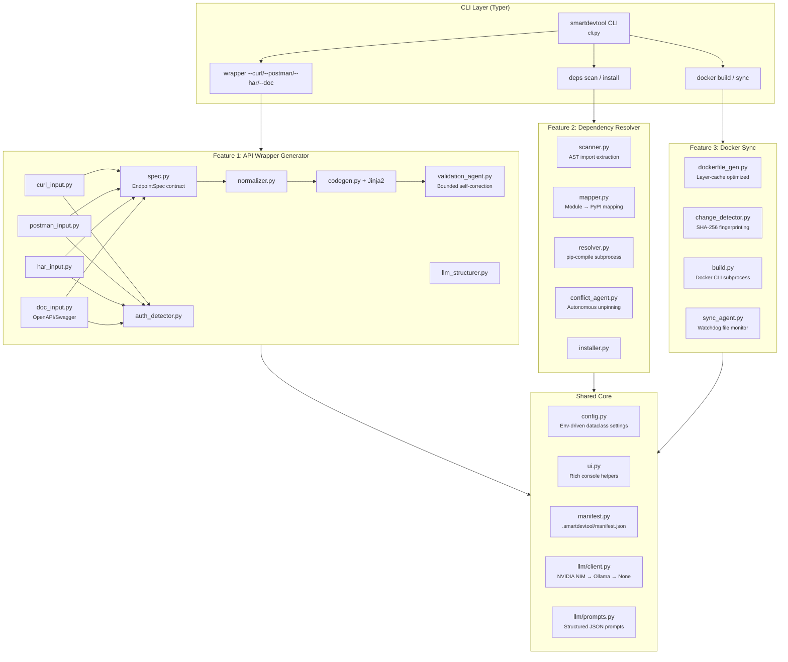
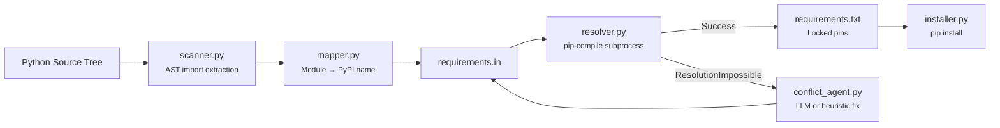
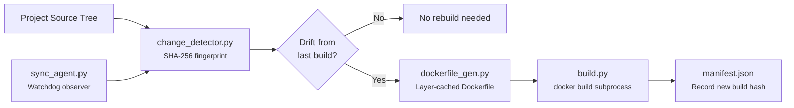

# Smart DevTool — Full Project Analysis & Deployment Guide

---

## Table of Contents

1. [What Is Smart DevTool?](#1-what-is-smart-devtool)
2. [What Problem Does It Solve?](#2-what-problem-does-it-solve)
3. [Architecture Deep-Dive](#3-architecture-deep-dive)
4. [Complete File Map](#4-complete-file-map)
5. [How Each Feature Works (Internals)](#5-how-each-feature-works-internals)
6. [How to Install & Run](#6-how-to-install--run)
7. [CLI Command Reference](#7-cli-command-reference)
8. [Configuration & Environment Variables](#8-configuration--environment-variables)
9. [How to Deploy](#9-how-to-deploy)
10. [Test Suite & Quality](#10-test-suite--quality)
11. [Security Considerations](#11-security-considerations)
12. [Limitations & Known Constraints](#12-limitations--known-constraints)

---

## 1. What Is Smart DevTool?

**Smart DevTool** is a production-grade **CLI tool and Python library** that automates three core developer pain points:

| Feature | What It Does |
|:---|:---|
| **API Wrapper Generator** | Takes a cURL command, Postman collection, HAR network capture, or OpenAPI spec and generates a fully typed, production-ready Python SDK client class — with auth, retries, and docstrings. |
| **Dependency Resolver** | Scans your Python codebase, identifies all third-party imports, maps them to PyPI packages, and resolves version conflicts autonomously using a real `pip-compile` backtracking solver. |
| **Docker Sync Agent** | Generates optimized, layer-cached Dockerfiles and watches your filesystem for changes, automatically detecting drift and triggering rebuilds only when necessary. |

All three features share a common core: a unified CLI, Rich-powered terminal UI, manifest-based state tracking, and an optional LLM integration (NVIDIA NIM / Ollama) that degrades cleanly to deterministic heuristics when offline.

> [!IMPORTANT]
> **Offline-First Design**: Every feature works without any API keys, network access, or LLM. The LLM is only used to enhance decisions — never as a hard dependency.

---

## 2. What Problem Does It Solve?

### For Individual Developers
- **"I have a cURL command from the docs, I need a Python client"** → `smartdevtool wrapper --curl "..."` generates a full SDK class in seconds.
- **"My requirements conflict and pip gives cryptic errors"** → `smartdevtool deps install --auto-resolve` autonomously fixes version conflicts.
- **"My Docker image is stale but I don't know what changed"** → `smartdevtool docker sync --watch` detects file drift and rebuilds only when needed.

### For Teams
- **Reproducible environments** via pinned lockfiles + SHA-256 fingerprinted Docker images.
- **Manifest tracking** (`.smartdevtool/manifest.json`) records every generated wrapper, resolved dependency, and Docker build — so teams can audit exactly what was produced and when.

---

## 3. Architecture Deep-Dive

### System Architecture Diagram



### Design Principles

| Principle | Implementation |
|:---|:---|
| **Offline-First** | LLM client falls back to `None` silently; every agent has a deterministic heuristic path. |
| **Secrets Discipline** | Auth tokens detected from cURL/HAR are converted to `os.getenv("ENV_VAR_NAME")` — never hardcoded in generated code. |
| **Bounded Agents** | Every agentic loop has `max_iters` (default 8 for deps, 6 for wrapper). Loops terminate deterministically. |
| **Ground Truth Verification** | Dependency resolver uses `pip-compile` exit code as truth. Wrapper validation uses real HTTP status codes. |
| **Cross-Platform** | Windows-safe ASCII glyphs, UTF-8 BOM handling, `safe_box=True` for Rich console rendering. |

---

## 4. Complete File Map

```
d:\Project\smartdevtoolv1\
├── pyproject.toml                          # Package config, deps, entry points
├── README.md                               # Project documentation
├── .env.example                            # Environment variable template
├── .gitignore                              # Git exclusion patterns
├── requirements.txt                        # Generated lockfile (output)
│
├── smartdevtool/                           # Main Python package
│   ├── __init__.py                         # Package metadata
│   ├── cli.py                              # Typer CLI entry point (401 lines)
│   ├── config.py                           # Env-driven Config dataclass
│   ├── ui.py                               # Rich console helpers
│   ├── manifest.py                         # .smartdevtool/manifest.json manager
│   │
│   ├── llm/                                # LLM integration layer
│   │   ├── __init__.py
│   │   ├── client.py                       # Provider chain: NVIDIA → Ollama → None
│   │   └── prompts.py                      # All structured JSON prompt templates
│   │
│   ├── deps/                               # Feature 2: Dependency Resolver
│   │   ├── __init__.py                     # Public API exports
│   │   ├── scanner.py                      # AST import extraction
│   │   ├── mapper.py                       # Module-to-PyPI mapping
│   │   ├── resolver.py                     # pip-compile subprocess wrapper
│   │   ├── conflict_agent.py               # Autonomous conflict resolution agent
│   │   └── installer.py                    # pip install subprocess wrapper
│   │
│   ├── wrapper/                            # Feature 1: API Wrapper Generator
│   │   ├── __init__.py                     # Public API exports
│   │   ├── spec.py                         # EndpointSpec / EndpointDef dataclasses
│   │   ├── auth_detector.py                # Header/scheme → AuthInfo classifier
│   │   ├── normalizer.py                   # Multi-spec merger & deduplication
│   │   ├── codegen.py                      # Jinja2 renderer + ast.parse validation
│   │   ├── llm_structurer.py               # LLM fallback for unstructured docs
│   │   ├── validation_agent.py             # Bounded HTTP self-correction agent
│   │   ├── inputs/                         # Input parsers
│   │   │   ├── __init__.py
│   │   │   ├── curl_input.py               # shlex-based cURL parser
│   │   │   ├── postman_input.py            # Postman Collection v2.1 parser
│   │   │   ├── har_input.py                # HTTP Archive parser
│   │   │   └── doc_input.py                # OpenAPI/Swagger 2.0 & 3.x parser
│   │   └── templates/
│   │       └── wrapper_template.py.jinja   # SDK codegen template
│   │
│   └── docker/                             # Feature 3: Docker Sync
│       ├── __init__.py                     # Public API exports
│       ├── dockerfile_gen.py               # Layer-cached Dockerfile generator
│       ├── change_detector.py              # SHA-256 source tree fingerprinter
│       ├── build.py                        # Docker CLI subprocess wrapper
│       └── sync_agent.py                   # Watchdog-based filesystem monitor
│
├── tests/                                  # Test suite (46 tests)
│   ├── conftest.py
│   ├── test_core.py                        # Config, UI, Manifest, LLM client
│   ├── test_conflict_agent.py              # Real PyPI conflict scenarios
│   ├── test_deps_cli.py                    # CLI integration for deps
│   ├── test_deps_resolver.py               # pip-compile subprocess tests
│   ├── test_deps_scanner.py                # AST scanner tests
│   ├── test_docker_change_detector.py      # SHA-256 fingerprint tests
│   ├── test_docker_cli.py                  # CLI integration for docker
│   ├── test_docker_dockerfile_gen.py       # Dockerfile generation tests
│   ├── test_docker_sync.py                 # Sync agent + live Docker tests
│   ├── test_wrapper_cli.py                 # CLI integration for wrapper
│   ├── test_wrapper_codegen.py             # Jinja2 codegen + ast.parse tests
│   ├── test_wrapper_parsers.py             # All 4 input parser tests
│   └── test_wrapper_validation.py          # HTTP self-correction tests
│
├── dist/                                   # Built distributions
│   └── smartdevtool-0.1.0-py3-none-any.whl
│
└── .smartdevtool/                          # Runtime state directory
    └── manifest.json                       # Tracked project state
```

---

## 5. How Each Feature Works (Internals)

### Feature 1: API Wrapper Generator

```mermaid
flowchart LR
    A["Input Source<br/>cURL / Postman / HAR / OpenAPI"] --> B["Parser<br/><small>curl_input.py etc.</small>"]
    B --> C["EndpointSpec<br/><small>Normalized contract</small>"]
    C --> D["auth_detector.py<br/><small>Classify auth → env vars</small>"]
    D --> E["normalizer.py<br/><small>Merge & deduplicate</small>"]
    E --> F["codegen.py<br/><small>Jinja2 → Python SDK</small>"]
    F --> G["ast.parse()<br/><small>Syntax validation</small>"]
    G --> H["validation_agent.py<br/><small>Test GET endpoints</small>"]
    H --> I["Generated SDK .py file"]
```



**How it works step-by-step:**

1. **Parsing** — Each parser (`CurlParser`, `PostmanParser`, `HarParser`, `DocParser`) converts its input format into a unified `EndpointSpec` dataclass containing `EndpointDef` objects (method, path, parameters, body samples) and `AuthInfo` (type, header, env var names).

2. **Auth Detection** — The `auth_detector.py` module classifies headers like `Authorization: Bearer xxx` into structured `AuthInfo` objects. Real tokens are *never* embedded — they're converted to environment variable references (`os.getenv("API_TOKEN")`).

3. **Normalization** — `normalizer.py` merges multiple `EndpointSpec` objects (when you pass multiple inputs) by deduplicating endpoints on `(method, path)`.

4. **Code Generation** — `codegen.py` renders a Jinja2 template ([`wrapper_template.py.jinja`](file:///d:/Project/smartdevtoolv1/smartdevtool/wrapper/templates/wrapper_template.py.jinja)) producing a complete Python SDK class with `requests`, retry logic, dataclass payloads, and docstrings. Every generated file is validated with `ast.parse()` before being saved.

5. **Self-Correcting Validation** — `validation_agent.py` runs a bounded loop (default `max_iters=6`) that:
   - Only validates **GET endpoints** (never touches mutating POST/PUT/DELETE for safety)
   - Immediately aborts on 403 or 5xx (structurally unfixable)
   - On 401: tries LLM suggestion → deterministic header-swap heuristic
   - Re-generates and re-tests until HTTP < 400 or budget exhausted

---

### Feature 2: Dependency Resolver



**How it works step-by-step:**

1. **AST Scanning** — `scanner.py` walks your project tree, parses every `.py` file with `ast.parse`, and extracts all `import` and `from ... import` statements. It filters out stdlib modules, local project modules, and known ignore directories.

2. **PyPI Mapping** — `mapper.py` maps module names to their canonical PyPI distribution names (e.g., `yaml` → `PyYAML`, `PIL` → `Pillow`, `dateutil` → `python-dateutil`).

3. **Resolution** — `resolver.py` writes a `requirements.in` and runs the real `pip-compile` binary with `--resolver=backtracking --upgrade` flags. The output is a fully pinned `requirements.txt`.

4. **Conflict Resolution** — If `pip-compile` fails with `ResolutionImpossible`, the `conflict_agent.py` kicks in with a bounded loop:
   - **Strategy 1 (LLM)**: Asks the LLM to propose a specific constraint fix (relax pin, unpin, or remove a package). The LLM response is structured JSON.
   - **Strategy 2 (Heuristic)**: Counts how many times each pinned package appears in the error text, and unpins the most-implicated package first.
   - Re-runs `pip-compile` and checks if the conflict is resolved. Repeats up to `max_iters` (default 8).

5. **Installation** — `installer.py` runs `pip install -r requirements.txt` with optional `--dry-run` and venv isolation.

---

### Feature 3: Docker Sync



**How it works step-by-step:**

1. **Change Detection** — `change_detector.py` computes a SHA-256 hash of all tracked source files + the dependency lockfile. This hash is compared against the one stored from the last successful Docker build in `manifest.json`.

2. **Dockerfile Generation** — `dockerfile_gen.py` renders a layer-cache-optimized Dockerfile with three distinct layers:
   - **Layer 1**: System packages (`apt-get`) — cached unless system deps change
   - **Layer 2**: Python dependencies (`pip install -r requirements.txt`) — cached unless requirements change
   - **Layer 3**: Application code (`COPY . /app`) — invalidated on any code change
   
   For base image selection, it checks if GPU/ML libraries (torch, tensorflow, jax) are present and selects an appropriate CUDA image; otherwise defaults to `python:3.11-slim`.

3. **Docker Build** — `build.py` wraps the `docker` CLI binary via subprocess. If Docker is not installed or the daemon isn't running, it degrades gracefully with actionable instructions.

4. **Watchdog Sync** — `sync_agent.py` uses Python's `watchdog` library to monitor filesystem events. On file changes, it debounces events (2-second window), re-runs drift detection, and triggers rebuilds if needed — with one human confirmation gate.

---

## 6. How to Install & Run

### Prerequisites
- **Python 3.11+** (required by `pyproject.toml`)
- **pip** and **venv** (standard Python tooling)
- **Docker** (optional, only needed for Feature 3 build/sync)

### Option A: Developer Installation (Editable)

```bash
# 1. Clone or navigate to the project
cd d:\Project\smartdevtoolv1

# 2. Create a virtual environment
python -m venv .venv

# 3. Activate it
# Windows:
.venv\Scripts\activate
# Linux/macOS:
source .venv/bin/activate

# 4. Install in editable mode with dev dependencies
pip install -e ".[dev]"

# 5. Verify installation
smartdevtool version
# Output: smartdevtool v0.1.0
```

### Option B: Install from Built Wheel

```bash
# The wheel is already built at:
pip install dist/smartdevtool-0.1.0-py3-none-any.whl

# Verify
smartdevtool --help
```

### Option C: Build a Fresh Wheel

```bash
pip install build
python -m build
# Output: dist/smartdevtool-0.1.0-py3-none-any.whl
pip install dist/smartdevtool-0.1.0-py3-none-any.whl
```

---

## 7. CLI Command Reference

### Global Commands

```bash
smartdevtool --help          # Show all available commands
smartdevtool version         # Show version (v0.1.0)
```

---

### Feature 1: `smartdevtool wrapper`

Generate typed Python SDK wrappers from various API specification sources.

| Command | Description |
|:---|:---|
| `--curl "<curl_command>"` | Parse a cURL command string |
| `--postman <file.json>` | Parse a Postman Collection v2.x file |
| `--har <file.har>` | Parse an HTTP Archive capture |
| `--doc <file_or_url>` | Parse OpenAPI/Swagger spec (JSON or YAML) |
| `--name <ClassName>` | Override the generated SDK class name |
| `--output-dir <dir>` | Directory to save generated SDK (default: `.`) |
| `--base-url <url>` | Override the base URL |
| `--no-llm` | Skip LLM structurer and validation suggestions |
| `--no-validate` | Skip automated GET endpoint validation |
| `--max-iters <n>` | Max validation retry iterations (default: 6) |
| `-y / --yes` | Auto-confirm all prompts |

**Examples:**

```bash
# From a cURL command
smartdevtool wrapper \
  --curl "curl -X GET https://api.github.com/repos/octocat/hello-world -H 'Authorization: Bearer ghp_xxx'" \
  --name GitHubAPI

# From Postman
smartdevtool wrapper --postman ./my_collection.json --name MyAPI

# From HAR (browser network export)
smartdevtool wrapper --har ./network_traffic.har

# From OpenAPI spec
smartdevtool wrapper --doc ./openapi.yaml --name PetstoreAPI

# Non-interactive, no LLM, no validation
smartdevtool wrapper --curl "curl https://api.example.com/v1/data" --no-llm --no-validate -y
```

---

### Feature 2: `smartdevtool deps`

Scan, resolve, and install Python dependencies.

| Command | Description |
|:---|:---|
| `deps scan <path>` | Read-only scan of third-party imports |
| `deps install <path>` | Full resolve + install pipeline |
| `--dry-run` | Resolve without installing |
| `--no-llm` | Use deterministic heuristic conflict resolution only |
| `--venv` | Install into isolated `.smartdevtool/venv` |
| `-y / --yes` | Auto-confirm prompts |
| `--max-iters <n>` | Max conflict resolution iterations (default: 8) |
| `-o / --output <file>` | Output lockfile path (default: `requirements.txt`) |

**Examples:**

```bash
# Scan imports in current directory
smartdevtool deps scan .

# Full pipeline: scan → resolve → install (dry-run)
smartdevtool deps install . --dry-run --no-llm -y

# Resolve and install for real
smartdevtool deps install ./my_project -y

# Resolve with custom output
smartdevtool deps install . -o locked-requirements.txt -y
```

---

### Feature 3: `smartdevtool docker`

Generate Dockerfiles and synchronize container builds.

| Command | Description |
|:---|:---|
| `docker build <path>` | Generate Dockerfile and build image |
| `docker sync <path>` | Detect drift and rebuild if necessary |
| `-t / --tag <tag>` | Docker image tag (default: `smartdevtool:latest`) |
| `--watch / -w` | Continuously watch for filesystem changes |
| `--no-llm` | Skip LLM base image suggestion |
| `-y / --yes` | Auto-confirm rebuild prompts |

**Examples:**

```bash
# Generate optimized Dockerfile and build
smartdevtool docker build . -t myapp:v1.0 -y

# One-shot drift check
smartdevtool docker sync .

# Continuous watch mode
smartdevtool docker sync . --watch -t myapp:latest
```

---

## 8. Configuration & Environment Variables

Smart DevTool reads configuration from environment variables (or a `.env` file via `python-dotenv`). Copy the template:

```bash
cp .env.example .env
```

### All Configuration Variables

| Variable | Default | Description |
|:---|:---|:---|
| `NVIDIA_API_KEY` | *(empty)* | NVIDIA NIM API key. If set, NIM is the primary LLM provider. |
| `NVIDIA_BASE_URL` | `https://integrate.api.nvidia.com/v1` | NVIDIA NIM endpoint URL |
| `NVIDIA_MODEL` | `meta/llama-3.1-70b-instruct` | NVIDIA NIM model name |
| `OLLAMA_HOST` | `http://localhost:11434` | Local Ollama server URL |
| `OLLAMA_MODEL` | `llama3.1` | Ollama model name |
| `MAX_ITERS_DEPS` | `8` | Max conflict resolution iterations |
| `MAX_ITERS_WRAPPER` | `6` | Max wrapper validation iterations |
| `SMARTDEVTOOL_OFFLINE_MODE` | `false` | Force offline mode (disable all LLM calls) |
| `SMARTDEVTOOL_LOG_LEVEL` | `INFO` | Logging level |
| `SMARTDEVTOOL_MANIFEST_DIR` | `.smartdevtool` | Manifest storage directory |

### LLM Provider Priority Chain

```
1. NVIDIA NIM (if NVIDIA_API_KEY is set and non-empty)
      ↓ fallback
2. Local Ollama (if server responds at OLLAMA_HOST/api/tags)
      ↓ fallback
3. None (deterministic heuristics only — fully functional)
```

> [!TIP]
> **For fully offline usage**: Set `SMARTDEVTOOL_OFFLINE_MODE=true` in your `.env`. All features work without any LLM.

---

## 9. How to Deploy

### Deployment Option 1: PyPI Package (Recommended for Distribution)

```bash
# 1. Build the distribution
python -m build
# Creates: dist/smartdevtool-0.1.0-py3-none-any.whl
#          dist/smartdevtool-0.1.0.tar.gz

# 2. Upload to PyPI (or your private registry)
pip install twine
twine upload dist/*

# 3. Users install with:
pip install smartdevtool
```

**For a private PyPI registry (e.g., AWS CodeArtifact, GCP Artifact Registry, Azure Artifacts):**
```bash
twine upload --repository-url https://your-private-registry.example.com/simple/ dist/*
```

---

### Deployment Option 2: Docker Container

Build a Docker container that ships `smartdevtool` as a pre-installed CLI:

```dockerfile
FROM python:3.11-slim

WORKDIR /app

# Install the tool
COPY dist/smartdevtool-0.1.0-py3-none-any.whl /tmp/
RUN pip install --no-cache-dir /tmp/smartdevtool-0.1.0-py3-none-any.whl && \
    rm /tmp/smartdevtool-0.1.0-py3-none-any.whl

# Set offline mode by default in containers
ENV SMARTDEVTOOL_OFFLINE_MODE=true

ENTRYPOINT ["smartdevtool"]
CMD ["--help"]
```

```bash
# Build the tool image
docker build -t smartdevtool:0.1.0 .

# Run a command
docker run --rm smartdevtool:0.1.0 version
docker run --rm -v $(pwd):/workspace smartdevtool:0.1.0 deps scan /workspace
```

---

### Deployment Option 3: CI/CD Pipeline Integration

#### GitHub Actions

```yaml
name: Smart DevTool CI

on: [push, pull_request]

jobs:
  lint-and-test:
    runs-on: ubuntu-latest
    steps:
      - uses: actions/checkout@v4
      - uses: actions/setup-python@v5
        with:
          python-version: '3.11'

      - name: Install Smart DevTool
        run: pip install -e ".[dev]"

      - name: Run test suite
        run: pytest -v

      - name: Scan project dependencies
        run: smartdevtool deps scan .

      - name: Resolve dependencies (dry-run)
        run: smartdevtool deps install . --dry-run --no-llm -y
```

#### GitLab CI

```yaml
stages:
  - test
  - scan

test:
  stage: test
  image: python:3.11-slim
  script:
    - pip install -e ".[dev]"
    - pytest -v

dependency-scan:
  stage: scan
  image: python:3.11-slim
  script:
    - pip install -e ".[dev]"
    - smartdevtool deps scan .
    - smartdevtool deps install . --dry-run --no-llm -y
  artifacts:
    paths:
      - requirements.txt
```

---

### Deployment Option 4: Team Internal Tool Server

For teams wanting a centralized installation:

```bash
# On a shared server or dev container
pip install smartdevtool-0.1.0-py3-none-any.whl

# Set up environment for LLM support (optional)
export NVIDIA_API_KEY="nvapi-..."
# or ensure Ollama is running locally:
# ollama serve &
# ollama pull llama3.1

# All team members access via PATH
smartdevtool --help
```

---

### Deployment Option 5: As a Python Library (Programmatic Use)

Smart DevTool can also be imported and used as a Python library:

```python
from smartdevtool.deps import ImportScanner, map_imports, DependencyResolver
from smartdevtool.wrapper import CurlParser, Normalizer, WrapperGenerator
from smartdevtool.docker import DockerfileGenerator, ChangeDetector

# Example: Scan imports programmatically
scanner = ImportScanner(project_root="./my_project")
imports = scanner.scan()
dist_map = map_imports(sorted(imports))
print(dist_map)  # {'requests': 'requests', 'yaml': 'PyYAML', ...}

# Example: Generate a wrapper from cURL
spec = CurlParser('curl -X GET https://api.example.com/v1/users -H "Authorization: Bearer token"').parse()
generator = WrapperGenerator(spec)
generator.write("./my_sdk_client.py")

# Example: Detect Docker drift
detector = ChangeDetector("./my_project")
is_drift, current_hash, files = detector.detect_drift(last_build_hash="abc123...")
```

---

## 10. Test Suite & Quality

### Running Tests

```bash
# Full suite
pytest -v

# Specific feature
pytest tests/test_wrapper_*.py -v
pytest tests/test_deps_*.py -v
pytest tests/test_docker_*.py -v

# With coverage
pytest --cov=smartdevtool --cov-report=term-missing
```

### Test Results (Verified)

```
tests/test_conflict_agent.py ...                                         [  6%]
tests/test_core.py .....                                                 [ 17%]
tests/test_deps_cli.py ..                                                [ 21%]
tests/test_deps_resolver.py ...                                          [ 28%]
tests/test_deps_scanner.py ..                                            [ 32%]
tests/test_docker_change_detector.py ...                                 [ 39%]
tests/test_docker_cli.py ..                                              [ 43%]
tests/test_docker_dockerfile_gen.py ....                                 [ 52%]
tests/test_docker_sync.py ....s                                          [ 63%]
tests/test_wrapper_cli.py ....                                           [ 71%]
tests/test_wrapper_codegen.py ....                                       [ 80%]
tests/test_wrapper_parsers.py .....                                      [ 91%]
tests/test_wrapper_validation.py ....                                    [100%]

======================= 45 passed, 1 skipped in 33.87s ========================
```

> [!NOTE]
> The 1 skipped test (`test_docker_sync.py::test_sync_agent_live_docker`) is the live Docker daemon integration test. It auto-skips when Docker is not running — this is intentional graceful degradation.

### Test Coverage by Feature

| Feature | Test Files | Tests | Status |
|:---|:---|:---:|:---:|
| Shared Core | `test_core.py` | 5 | ✅ |
| Dependency Scanner | `test_deps_scanner.py` | 2 | ✅ |
| Dependency Resolver | `test_deps_resolver.py` | 3 | ✅ |
| Conflict Agent | `test_conflict_agent.py` | 3 | ✅ |
| Deps CLI | `test_deps_cli.py` | 2 | ✅ |
| Wrapper Parsers | `test_wrapper_parsers.py` | 5 | ✅ |
| Wrapper Codegen | `test_wrapper_codegen.py` | 4 | ✅ |
| Wrapper Validation | `test_wrapper_validation.py` | 4 | ✅ |
| Wrapper CLI | `test_wrapper_cli.py` | 4 | ✅ |
| Docker Dockerfile Gen | `test_docker_dockerfile_gen.py` | 4 | ✅ |
| Docker Change Detector | `test_docker_change_detector.py` | 3 | ✅ |
| Docker Sync Agent | `test_docker_sync.py` | 4+1s | ✅ |
| Docker CLI | `test_docker_cli.py` | 2 | ✅ |

---

## 11. Security Considerations

| Area | Protection |
|:---|:---|
| **Secrets in generated code** | Auth tokens are transformed to `os.getenv("ENV_VAR_NAME")` — never hardcoded. |
| **`.env` file** | Listed in `.gitignore`. The `.env.example` template contains only empty placeholders. |
| **LLM API keys** | Read from environment variables only; never logged or persisted. |
| **Subprocess safety** | `pip-compile` and `docker` are invoked via `subprocess.run()` with explicit argument lists (no shell injection). |
| **Validation agent scope** | Only tests GET endpoints. POST/PUT/PATCH/DELETE are explicitly excluded from automated testing. |
| **Bounded execution** | All agentic loops have hard `max_iters` limits to prevent runaway execution. |

---

## 12. Limitations & Known Constraints

| Limitation | Details |
|:---|:---|
| **Python only** | Wrapper generation produces Python SDK clients only. No TypeScript, Go, etc. |
| **Python 3.11+ required** | Uses `sys.stdlib_module_names` (3.10+) and `X \| Y` union syntax (3.10+). |
| **OpenAPI input** | `doc_input.py` handles Swagger 2.0 and OpenAPI 3.x but may not handle every edge case of complex specifications (e.g., deeply nested `$ref` chains, polymorphism via `allOf`/`oneOf`). |
| **Docker Feature** | Requires Docker CLI on PATH. Does not support Podman or other container runtimes natively. |
| **LLM quality** | LLM suggestions are best-effort. The system always works without LLM via deterministic heuristics. |
| **No GUI** | This is a CLI/library tool. No web dashboard or IDE plugin (yet). |
| **Single-language scanning** | The dependency scanner only processes Python `.py` files. It does not scan Jupyter notebooks, Cython, or other formats. |

---

> [!TIP]
> **Quick Start Cheat Sheet:**
> ```bash
> pip install -e ".[dev]"              # Install
> smartdevtool deps scan .             # Scan your project's imports
> smartdevtool deps install . -y       # Resolve + install dependencies
> smartdevtool wrapper --curl "..."    # Generate SDK from cURL
> smartdevtool docker build . -y       # Generate Dockerfile + build
> pytest -v                            # Run all tests
> ```
