# Smart DevTool — Verification Walkthrough & Architecture Report

Smart DevTool is a production-grade CLI and Python library that automates API integration, dependency conflict resolution, and container environment synchronization.

---

## 1. Test Suite Results

All 46 test cases were executed across the entire codebase with the following result:
```text
============================= test session starts =============================
platform win32 -- Python 3.11.6, pytest-8.3.5, pluggy-1.5.0
rootdir: D:\Project\smartdevtoolv1
configfile: pyproject.toml
testpaths: tests
plugins: anyio-4.12.1, Faker-40.1.0, langsmith-0.6.4, cov-7.1.0
collected 46 items

tests\test_conflict_agent.py ...                                         [  6%]
tests\test_core.py .....                                                 [ 17%]
tests\test_deps_cli.py ..                                                [ 21%]
tests\test_deps_resolver.py ...                                          [ 28%]
tests\test_deps_scanner.py ..                                            [ 32%]
tests\test_docker_change_detector.py ...                                 [ 39%]
tests\test_docker_cli.py ..                                              [ 43%]
tests\test_docker_dockerfile_gen.py ....                                 [ 52%]
tests\test_docker_sync.py ....s                                          [ 63%]
tests\test_wrapper_cli.py ....                                           [ 71%]
tests\test_wrapper_codegen.py ....                                       [ 80%]
tests\test_wrapper_parsers.py .....                                      [ 91%]
tests\test_wrapper_validation.py ....                                    [100%]

======================= 45 passed, 1 skipped in 33.87s ========================
```
> [!NOTE]
> `test_docker_sync.py::test_sync_agent_live_docker` was skipped automatically because the Docker daemon was not active on the host machine. The test suite exercises full mock/offline fallback paths for all Docker functionality.

---

## 2. Core Architecture & Implemented Features

```mermaid
graph TD
    CLI[smartdevtool CLI] --> Core[Shared Core]
    Core --> Config[config.py]
    Core --> UI[ui.py Rich Helpers]
    Core --> Manifest[manifest.py Manifest]
    Core --> LLM[llm/client.py Fallback Chain]

    CLI --> F1[Feature 1: API Wrapper Generator]
    F1 --> Parsers[Parsers: cURL, Postman, HAR, OpenAPI/Doc]
    F1 --> Normalizer[normalizer.py & auth_detector.py]
    F1 --> Codegen[codegen.py + Jinja2 + ast.parse]
    F1 --> ValAgent[validation_agent.py Self-Correction]

    CLI --> F2[Feature 2: Dependency Resolver]
    F2 --> Scanner[scanner.py AST Import Extraction]
    F2 --> Mapper[mapper.py PyPI Package Mapping]
    F2 --> Resolver[resolver.py pip-compile Engine]
    F2 --> ConflictAgent[conflict_agent.py LLM + Heuristic Unpinning]
    F2 --> Installer[installer.py Isolated Pip Execution]

    CLI --> F3[Feature 3: Docker Sync]
    F3 --> DockerGen[dockerfile_gen.py Layer Caching]
    F3 --> ChangeDet[change_detector.py SHA-256 Fingerprinting]
    F3 --> BuildSub[build.py Docker CLI Subprocess]
    F3 --> SyncAgent[sync_agent.py Watchdog File Sync]
```



---

## 3. Real Bugs Caught & Fixed During Verification

1. **Windows Console Charset Encoding (`UnicodeEncodeError: 'charmap'`):**
   - *Problem*: Rich glyphs like `❯` and fancy box-drawing borders failed on default Windows consoles using code page 1252.
   - *Fix*: Created Windows-safe ASCII/Unicode fallback glyphs (`>`, `[OK]`, `[X]`, `[!]`) and configured `Console(safe_box=True)` in `smartdevtool/ui.py`.
2. **Windows UTF-8 BOM Parsing in AST Scanner:**
   - *Problem*: PowerShell-generated Python test fixtures prepended a UTF-8 BOM (`\xef\xbb\xbf`), causing `ast.parse` to crash with `SyntaxError: invalid non-printable character U+FEFF`.
   - *Fix*: Switched file reading in `smartdevtool/deps/scanner.py` to `encoding="utf-8-sig"`.
3. **Missing Jinja2 Packaging Data in Wheel Distribution:**
   - *Problem*: In clean-room installations from `.whl`, `wrapper_template.py.jinja` was omitted because setuptools defaults to python source only.
   - *Fix*: Added `[tool.setuptools.package-data] "smartdevtool.wrapper" = ["templates/*.jinja"]` to `pyproject.toml`.
4. **Clean-Room Dependency Isolation:**
   - *Problem*: `smartdevtool/wrapper/inputs/doc_input.py` imported `yaml`, but `pyyaml` was missing from `pyproject.toml` runtime dependencies.
   - *Fix*: Added `pyyaml>=6.0.0` to `dependencies` in `pyproject.toml` and verified in clean virtualenvs.
5. **Pip ResolutionImpossible on Non-Existent Packages:**
   - *Problem*: When pip fails due to an invalid package name (e.g., `invalid_pkg_12345`), `ResolutionImpossible` is thrown. The conflict resolver would previously attempt to unpin a non-existent version.
   - *Fix*: Added pre-checks for `no matching distribution found` and `from versions: none` to fail fast with actionable guidance.

---

## 4. Verification Checkpoints Completed

| Phase | Milestone | Verification Method | Status |
| :--- | :--- | :--- | :---: |
| **Phase 0** | Scaffold & Dependencies | `pip install -e ".[dev]"` | Pass |
| **Phase 1** | Shared Core Architecture | `tests/test_core.py` (Config, UI, Manifest, LLM) | Pass |
| **Phase 2** | Feature 2 Dependency Resolver | Real PyPI conflict test (`requests==2.20.0` + `urllib3==2.0.0`) | Pass |
| **Phase 3** | Clean-Room Feature 2 | Built `.whl` in `.clean_room_env` | Pass |
| **Phase 4** | Feature 1 Parsers & Spec | Unit tests on cURL, Postman, HAR, Doc fixtures | Pass |
| **Phase 5** | Normalizer & Codegen | `ast.parse()` validation on all generated Python wrappers | Pass |
| **Phase 6** | Validation Agent | Self-correction against local HTTP test server | Pass |
| **Phase 7** | Feature 1 CLI Integration | `smartdevtool wrapper` CLI tests | Pass |
| **Phase 8** | Clean-Room Features 1+2 | Built `.whl` in `.clean_room_env3` | Pass |
| **Phase 9** | Feature 3 Docker Layered Sync | Dockerfile generation & SHA-256 change detection | Pass |
| **Phase 10**| Final Clean-Room Verification | Installed wheel in `.final_clean_room_env` | Pass |
| **Phase 11**| Full Test Suite Execution | 45 passed, 1 skipped in 33.87s | Pass |
